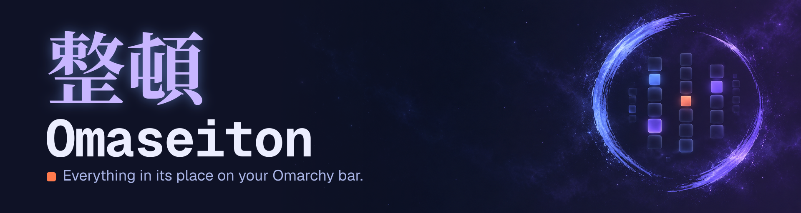
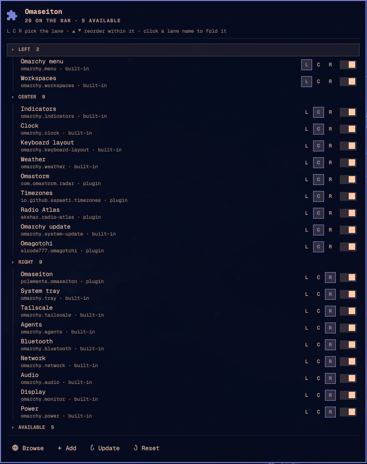
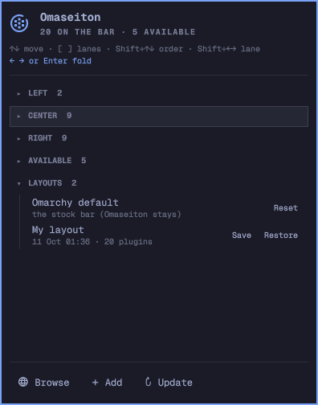

<p align="center">
  
</p>

<p align="center">
  <b>See every widget on your Omarchy bar, grouped by lane. Reorder, move and toggle them from one dropdown, and save and restore whole layouts.</b>
</p>

<p align="center">
  
  
</p>

---

> ### 整頓 · _seiton_ (せいとん)
>
> **Putting things in order.** In the Japanese **5S** method for keeping a workplace tidy, _seiton_ is the second step: "a place for everything, and everything in its place."
>
> **Omaseiton** is _Omarchy_ + _seiton_: it puts everything on your Omarchy bar in its place.

## What it is

Omaseiton is a bar widget for the [Omarchy](https://omarchy.org) shell. Click its icon and a dropdown lists every widget on your bar, split into **Left**, **Center** and **Right** lanes, followed by the bar widgets you have installed but switched off.

<p align="center">
  
  
</p>

<p align="center"><sub>Left: lanes as a tree, with the buttons for the highlighted row. Right: saving and restoring whole layouts.</sub></p>

More screenshots are tracked in [docs/SCREENSHOTS.md](docs/SCREENSHOTS.md).

|                      |                                                                                                                                                                                                                                                                                                                                     |
| -------------------- | ----------------------------------------------------------------------------------------------------------------------------------------------------------------------------------------------------------------------------------------------------------------------------------------------------------------------------------- |
| **A small tree**     | Each lane is a foldable node with its widgets nested underneath, in bar order, with the plugin id and whether it is built in, a plugin or a clone.                                                                                                                                                                                  |
| **Change lane**      | Every row has **L C R** buttons (**S C E** on a vertical bar). The current lane is filled in; click another to move the widget there.                                                                                                                                                                                               |
| **Reorder**          | Highlight a row and use its **▲ ▼** buttons (or `Shift+↑` `Shift+↓`) to move it earlier or later inside its lane.                                                                                                                                                                                                                   |
| **Toggle**           | Switch a widget off the bar, or switch an available one on. In the Available list the **L C R** buttons switch it on in that lane.                                                                                                                                                                                                  |
| **Native look**      | Built from Omarchy's own UI components and theme colours, so it follows `omarchy theme set` automatically.                                                                                                                                                                                                                          |
| **Keyboard first**   | Arrows move the highlight, `Shift`+arrows move the widget, `1` `2` `3` pick a lane, `Space` toggles. See [Keys](#keys).                                                                                                                                                                                                             |
| **Layouts**          | Save your bar as **My layout** and bring it back later, or return to the stock **Omarchy default**. A snapshot is taken automatically before every restore, and before **My layout** is overwritten, so any of them can be undone. What a restore changes is spelled out in [What it touches](#what-it-touches).                    |
| **Plugin shortcuts** | Browse the [Omarchy marketplace](https://plugins.omarchy.org), add a plugin from a git URL, or check your git plugins for updates. **Update** shows a short summary per plugin (new commits and a one-line stat, not a raw diff), asks, and then applies exactly the commit it showed you. See [Updating](#updating-other-plugins). |

## Install

```bash
omarchy plugin add https://github.com/p-clements/omaseiton.git --enable
```

Then look for the puzzle-piece icon on your bar.

To try a local copy while developing, copy the files into `~/.config/omarchy/plugins/io.github.p-clements.omaseiton/`, run `omarchy-shell shell rescanPlugins`, and enable it with `omarchy plugin enable io.github.p-clements.omaseiton`.

## Remove

```bash
omarchy plugin remove io.github.p-clements.omaseiton
rm -rf ~/.config/omaseiton ~/.local/state/omaseiton
```

The second line deletes your saved layouts and the small state files (see [Files it writes](#files-it-writes)). Skip it if you want to keep the layouts. Removing the plugin does not touch your bar's other widgets.

## Keys

The rule: **plain keys move the highlight, `Shift` moves the widget.** Inside a lane, up and down is the order; left and right is the lane.

| Key                              | Action                                                                                                |
| -------------------------------- | ----------------------------------------------------------------------------------------------------- |
| `↑` `↓` / `j` `k`                | Move the highlight                                                                                    |
| `Home` `End` / `g` `G`           | First / last row                                                                                      |
| `[` `]`                          | Jump to the previous / next lane                                                                      |
| `←` / `h`                        | On a widget: jump up to its lane. On a lane: fold it                                                  |
| `→` / `l`                        | On a lane: unfold it, or step into it if it is already open                                           |
| `Shift+↑` `Shift+↓` (or `K` `J`) | Move the widget earlier / later in its lane                                                           |
| `Shift+←` `Shift+→` (or `H` `L`) | Move the widget to the previous / next lane                                                           |
| `1` `2` `3`                      | Send the widget to the left / center / right lane. On an **Available** row, switch it on in that lane |
| `Space`                          | Switch the widget off. On an Available row, switch it on                                              |
| `x`                              | Switch the widget off                                                                                 |
| `Enter`                          | On a lane: fold or unfold. On Available: switch on. On a layout: restore it (press twice)             |
| `s`                              | On **My layout**: save the current bar                                                                |
| `Esc`                            | Cancel a pending restore, otherwise close                                                             |

The top of the dropdown always shows the keys that work everywhere, and a second line shows what the keys do for the row you are on. Letters are read from the key itself, so CapsLock does not change what they do, and a held-down key never repeats a change (switching off widget after widget, or confirming a restore that should take two deliberate presses).

On a vertical bar the same keys apply: lanes are Start / Center / End, and the lane buttons read **S C E**.

## What it touches

Omaseiton runs as you, unsandboxed, like every Omarchy shell plugin (see [SECURITY.md](SECURITY.md)). This is everything it reads, writes and runs.

### Changing your bar

1. **Moves, lane changes and on/off** go through the running shell, using the same calls `omarchy bar move` and `omarchy plugin enable` / `disable` use: `omarchy-shell shell moveBarWidget`, `enablePlugin` and `setPluginEnabled`. The shell then saves `shell.json` itself, as it does for those commands. Switching a widget off removes its entry from the layout, including inline settings such as the clock format. Omarchy does this, not Omaseiton, and switching it back on gives you the widget's defaults.
2. **Restoring a layout** (My layout, an automatic snapshot, or **Omarchy default**) is done by [`scripts/layout.sh`](scripts/layout.sh), and only after you press Restore twice. It replaces exactly these four settings in `~/.config/omarchy/shell.json`, and nothing else:

   - `bar.layout` (the lanes and their widgets, with each widget's inline settings)
   - `bar.position`
   - `bar.transparent`
   - `bar.centerAnchor`

   It never changes `bar.id` (which bar plugin is active), the `plugins` list, `disabledPlugins`, idle settings, or anything else in the file, even if a saved layout file contains such keys. A restore that would leave Omaseiton off the bar puts it back where it was, in the same write.

How the file is written: atomically, in the file's own directory, with its existing permissions. If `shell.json` is a symlink (a dotfiles repository, say), the file it points to is replaced and the link is left alone. Keys are written in sorted order, as Omarchy's own `omarchy bar` commands do. If anything fails, the write does not happen and the bar is left as it was.

**Omarchy default** works out the stock bar by running `omarchy bar defaults` in a throwaway home directory (so optional widgets for installed services are included), then applies it with the same single write as any other restore. Your widgets that are not on the stock bar come off, which is why the snapshot taken first matters.

Before any restore, the current bar is saved as an automatic snapshot (the newest five are kept, and a snapshot is only pruned after the restore succeeded). Saving **My layout** keeps the version it replaces as an automatic snapshot too. If the snapshot cannot be written, nothing is restored.

### Files it writes

| Path                                        | What                                                                                                               | When                            |
| ------------------------------------------- | ------------------------------------------------------------------------------------------------------------------ | ------------------------------- |
| `~/.config/omarchy/shell.json`              | The four settings above, and nothing else                                                                          | Restore, only after you confirm |
| `~/.config/omaseiton/layouts/*.json`        | **My layout** and the automatic snapshots                                                                          | Save, Restore                   |
| `~/.local/state/omaseiton/collapsed.json`   | Which lanes are folded                                                                                             | Folding a lane                  |
| `~/.local/state/omaseiton/cursor.json`      | Where the highlight was, so it survives the bar rebuilding after a move. Deleted as soon as it has been read       | Moves and switches              |
| `~/.local/state/omaseiton/reopen`           | A note naming the monitor whose dropdown should reopen after the bar rebuilds. Deleted as soon as it has been used | Moves, switches and restores    |
| `~/.config/omarchy/plugins/<other plugin>/` | A fast-forward of that plugin's git checkout                                                                       | Update, only after you say yes  |

### Updating other plugins

**Update** looks at every git-managed plugin in `~/.config/omarchy/plugins/`. For each one with something new it shows the new commits and a one-line stat, then asks. If you say yes, it merges exactly the commit it showed you (a fast-forward to that hash, never "whatever the remote has now"), runs Omarchy's own `omarchy-plugin-validate` on the result, and rolls back if that fails. It skips, with a reason, plugins that have local changes, have diverged from their remote, are symlinks, or have commits of their own. It does the validating and the shell rescan itself and does not call `omarchy-plugin-update`.

Plugin folders are other people's code, so git is run with the settings that make a hostile `.git/config` inert: no filesystem-monitor program, no hooks, and only the `https`, `ssh`, `git` and `file` transports allowed (through git's own allowlist variable, which overrides any setting in the repository).

### Network

Update fetches from the git remotes your plugins already have. **Add** runs Omarchy's `omarchy-plugin-add`, and **Browse** opens plugins.omarchy.org in your browser. Nothing else uses the network, and nothing is sent anywhere.

### Requirements

Omarchy 4 (the shell plugin system), `bash`, `jq`, `git`, GNU `findutils` and `coreutils`, and these Omarchy commands: `omarchy-shell`, `omarchy-launch-webapp`, `omarchy-launch-floating-terminal-with-presentation`, `omarchy-plugin-add` and `omarchy-plugin-validate`. `gum` is used for the Update question when present (Omarchy ships it) and a plain prompt is used otherwise.

### Not used

No elevated privileges, no system services installed or controlled, no bundled binaries, no telemetry, and no files outside the ones listed above.

## Development

```bash
node tests/layout.test.js          # row, move and key logic (no Quickshell needed)
bash tests/layout-script.test.sh   # save / restore / defaults, against throwaway files
bash tests/update-script.test.sh   # update summaries and safety, against throwaway git repos
node tests/mutation.test.js        # breaks the code on purpose; the tests must notice every break
bash tests/marketplace.sh          # the marketplace's own manifest and security checks (needs network)
omarchy plugin validate .          # Omarchy's manifest check
```

The shell tests run in a sandbox: a scratch `HOME`, guard commands that refuse to run `omarchy` or `omarchy-shell` for real, and a canary that fails the run if your real `shell.json` changes. The mutation check feeds deliberately broken scripts to those tests, so that sandbox is not optional.

Formatting and lint: `shellcheck` and `shfmt -i 2 -ci` for the shell scripts (the project uses 2 spaces, as Omarchy does), `prettier --check .` for the JavaScript, JSON and Markdown (QML is not covered by prettier; `.qmlformat.ini` holds the settings for `qmlformat`).

The row and move logic is in [`Layout.js`](Layout.js), the dropdown is [`Deck.qml`](Deck.qml), and the bar icon is [`BarWidget.qml`](BarWidget.qml).

## Roadmap

- Named layouts beyond "My layout"
- Per-widget settings from each plugin's declared schema
- Clone, open folder and remove actions per row
- "Update available" badges
- Drag and drop (Omarchy's bar already supports dragging icons directly)

## About the name

|             |                                                                                                                                                                                  |
| ----------- | -------------------------------------------------------------------------------------------------------------------------------------------------------------------------------- |
| **Kanji**   | 整頓                                                                                                                                                                             |
| **Reading** | せいとん (_seiton_)                                                                                                                                                              |
| **Meaning** | tidying up; putting in order; organizing                                                                                                                                         |
| **In 5S**   | The second of five workplace principles: 整理 _seiri_ (sort), **整頓 _seiton_ (set in order)**, 清掃 _seisō_ (shine), 清潔 _seiketsu_ (standardize), しつけ _shitsuke_ (sustain) |

The kanji and the brush circle on the banner are the idea in one picture: the calm, hand-drawn ensō around a strict grid of widgets.

## Credits

- The banner and emblem artwork was generated with ChatGPT's image generation, with no text in the image. The name, kanji and tagline were then added as vector text. The prompt and the build scripts are in [`assets/src`](assets/src), so the images can be rebuilt. I have not checked ChatGPT's terms for the generated images beyond what OpenAI publishes; the files are included on that basis.
- The banner and preview are typeset in Noto Serif CJK JP, JetBrains Mono (Nerd Font build) and Geist, all under the SIL Open Font License. The fonts are used to render the images and are not bundled.
- The screenshots are real renders of the dropdown.

## License

[MIT](LICENSE)
