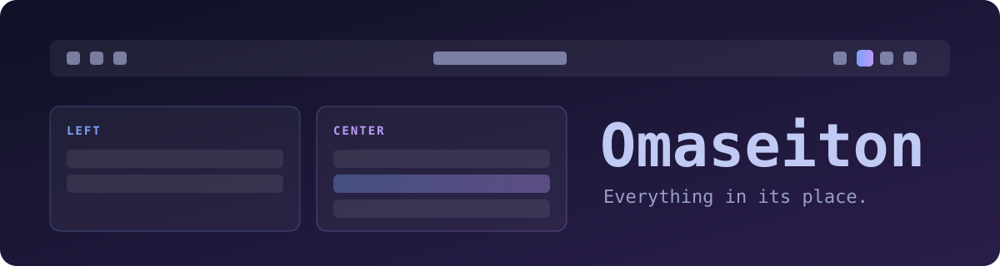

<p align="center">
  
</p>

<p align="center">
  <b>See every widget on your Omarchy bar, grouped by lane. Reorder, move and toggle them from one dropdown.</b>
</p>

<p align="center">
  
  
</p>

---

## The name

**Omaseiton** is *Omarchy* + **整頓 (seiton)**, the Japanese word for putting things in order. It is the second of the 5S workplace principles: "a place for everything, and everything in its place."

## What it is

Omaseiton is a bar widget for the [Omarchy](https://omarchy.org) shell. Click its icon and a dropdown lists every widget on your bar, split into **Left**, **Center** and **Right** lanes, followed by the bar widgets you have installed but switched off.

<p align="center">
  
</p>

More screenshots are tracked in [docs/SCREENSHOTS.md](docs/SCREENSHOTS.md).

| | |
|---|---|
| **A small tree** | Each lane is a foldable node with its widgets nested underneath, in bar order, with the plugin id and whether it is built in, a plugin or a clone. |
| **Change lane** | Every row has **L C R** buttons (**S C E** on a vertical bar). The current lane is filled in; click another to move the widget there. |
| **Reorder** | Highlight a row and use its **▲ ▼** buttons (or `Shift+↑` `Shift+↓`) to move it earlier or later inside its lane. |
| **Toggle** | Switch a widget off the bar, or switch an available one on. In the Available list the **L C R** buttons switch it on in that lane. |
| **Native look** | Built from Omarchy's own UI components and theme colours, so it follows `omarchy theme set` automatically. |
| **Keyboard first** | Arrows move the highlight, `Shift`+arrows move the widget, `1` `2` `3` pick a lane, `Space` toggles. See [Keys](#keys). |
| **Layouts** | Save your bar as **My layout** and bring it back later, or return to the stock **Omarchy default**. A snapshot is taken automatically before every restore, so a restore can always be undone. |
| **Plugin shortcuts** | Browse the [Omarchy marketplace](https://plugins.omarchy.org), add a plugin from a git URL, or check your git plugins for updates. **Update** shows a short summary per plugin (new commits and a one-line stat, not a raw diff) and asks before applying; the update itself is done by `omarchy-plugin-update`, so its safety checks and rollback still apply. |

## Install

```bash
omarchy plugin add https://github.com/<you>/omaseiton.git --enable
```

Then look for the puzzle-piece icon on your bar.

To install from a local clone while developing, copy the repo into `~/.config/omarchy/plugins/pclements.omaseiton/`, then run `omarchy-shell shell rescanPlugins` and enable it with `omarchy plugin enable pclements.omaseiton`.

## Remove

```bash
omarchy plugin remove pclements.omaseiton
```

## Keys

The rule: **plain keys move the highlight, `Shift` moves the widget.** Inside a lane, up and down is the order; left and right is the lane.

| Key | Action |
|---|---|
| `↑` `↓` / `j` `k` | Move the highlight |
| `Home` `End` / `g` `G` | First / last row |
| `[` `]` | Jump to the previous / next lane |
| `←` / `h` | On a widget: jump up to its lane. On a lane: fold it |
| `→` / `l` | On a lane: unfold it, or step into it if it is already open |
| `Shift+↑` `Shift+↓` (or `K` `J`) | Move the widget earlier / later in its lane |
| `Shift+←` `Shift+→` (or `H` `L`) | Move the widget to the previous / next lane |
| `1` `2` `3` | Send the widget to the left / center / right lane. On an **Available** row, switch it on in that lane |
| `Space` | Switch the widget off. On an Available row, switch it on |
| `x` | Switch the widget off |
| `Enter` | On a lane: fold or unfold. On Available: switch on. On a layout: restore it (press twice) |
| `s` | On **My layout**: save the current bar |
| `Esc` | Cancel a pending restore, otherwise close |

The top of the dropdown always shows the keys that work everywhere, and a second line shows what the keys do for the row you are on.

On a vertical bar the same keys apply: lanes are Start / Center / End, and the lane buttons read **S C E**.

## How it works, and what it touches

Moving and switching widgets never edits `shell.json` directly. Those changes go through the same shell calls the `omarchy bar` and `omarchy plugin` commands use:

| Action | Call |
|---|---|
| Reorder / change lane | `omarchy-shell shell moveBarWidget <id> <placement>` |
| Switch off | `omarchy-shell shell setPluginEnabled <id> false` |
| Switch on | `omarchy-shell shell enablePlugin <id> {}` |
| Browse / Add | `omarchy-launch-webapp`, `omarchy-plugin-add` |
| Update | [`scripts/update.sh`](scripts/update.sh), which calls `omarchy-plugin-update <id> --yes` only after you say yes |

**Restoring a layout is the one thing that writes `shell.json`**, and only when you press Restore (or Reset on "Omarchy default") twice. It works the way `omarchy bar` does: the file is replaced atomically, then the shell reloads it. Before anything is replaced, [`scripts/layout.sh`](scripts/layout.sh) saves a snapshot of the current layout to `~/.config/omaseiton/layouts/`, keeping the last five. If that snapshot fails, nothing is restored.

"Omarchy default" runs `omarchy bar defaults`, which puts the stock bar back and takes your other widgets (and their settings, such as the tray pin) off it. The snapshot taken first is what lets you get them back.

**Omaseiton always stays on the bar.** Whatever you restore, if the layout does not include Omaseiton it is put back exactly where it was, so the way to undo is never taken away.

Things worth knowing:

- **Switching a widget off removes its entry from the layout**, including inline settings such as the clock format. Omarchy does this, not Omaseiton. Switching it back on gives you the defaults.
- **The bar rebuilds after every change.** Omaseiton leaves a small marker file in `~/.local/state/omaseiton/` so the new instance reopens the dropdown. The marker is deleted straight away.
- **Folded lanes are remembered** in `~/.local/state/omaseiton/collapsed.json`. The Available list starts folded.
- Omaseiton will not offer to switch itself off.
- It does not use `sudo`, `systemctl`, the network, or bundled binaries.

## Develop

```bash
node tests/layout.test.js          # row and move logic, no Quickshell needed
bash tests/layout-script.test.sh   # layout save / restore, against temp files
bash tests/update-script.test.sh   # update summaries, against throwaway git repos
omarchy plugin validate .          # manifest check
```

The layout and move logic lives in [`Layout.js`](Layout.js) and is tested on its own. The UI is in [`Deck.qml`](Deck.qml) (the dropdown) and [`BarWidget.qml`](BarWidget.qml) (the bar icon).

## Roadmap

- Named layouts beyond "My layout"
- Per-widget settings from each plugin's declared schema
- Clone, open folder and remove actions per row
- "Update available" badges
- Drag and drop (Omarchy's bar already supports dragging icons directly)

## License

[MIT](LICENSE)
